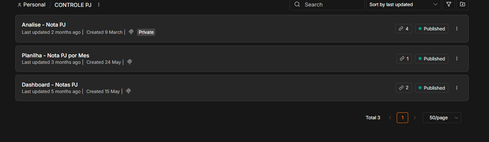
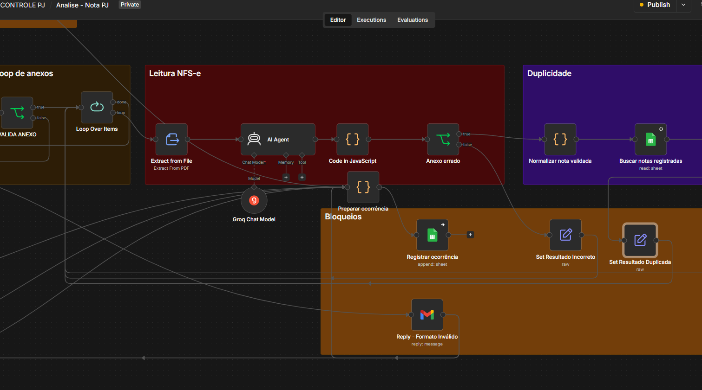

# Automação de Notas Fiscais | Processamento Inteligente de Documentos

## Visão geral

Automação para receber Notas Fiscais de Serviço eletrônicas por e-mail, validar os documentos, extrair informações com Inteligência Artificial e organizar os registros sem intervenção manual em cada mensagem.

## Problema

O processamento manual de notas recebidas por e-mail exige abrir mensagens, conferir anexos, identificar documentos inválidos ou repetidos, extrair campos, organizar arquivos e atualizar controles. A solução transforma essas etapas em um fluxo automatizado e rastreável.

## Funcionalidades implementadas

- Monitoramento periódico de e-mails pendentes.
- Filtro de mensagens automáticas e respostas indesejadas.
- Validação de existência, quantidade, formato e tamanho dos anexos.
- Extração de texto de arquivos PDF.
- Identificação de NFS-e e extração estruturada de campos por agente de IA.
- Normalização e validação dos dados extraídos.
- Detecção de notas duplicadas pela chave de acesso.
- Organização mensal dos arquivos no Google Drive.
- Registro dos dados e links no Google Sheets.
- Aplicação de marcadores para controlar o estado do processamento.
- Respostas automáticas para sucesso, duplicidade, ausência de anexo, excesso de arquivos, tamanho excedido ou formato inválido.

## Evidências visuais

*Workflows publicados para análise de notas, organização mensal e acompanhamento dos registros.*

*Trecho do processamento com extração de PDF, agente de IA, validação em JavaScript, consulta de duplicidades e registro de ocorrências.*

## Inteligência Artificial

O fluxo utiliza um agente de IA no n8n, integrado ao modelo **Llama 3.3 70B via Groq**, para transformar o texto extraído do PDF em um objeto JSON com campos definidos. O prompt restringe o processamento a NFS-e, rejeita documentos de outras categorias e exige retorno estruturado para validação nas etapas seguintes.

Essa implementação combina Prompt Engineering, saída estruturada, regras determinísticas e validação posterior. A IA executa a leitura sem substituir os controles de formato, limites, duplicidade e consistência do processo.

## Funcionalidades em implementação

- Suporte ao recebimento e processamento de documentos fiscais em XML.
- Integração com API de OCR como fallback para PDFs sem camada de texto.

## Arquitetura e tecnologias

**n8n, JavaScript, Gmail API, Google Drive, Google Sheets, agentes LangChain, Groq, Llama 3.3, JSON e APIs REST.**

Fluxo principal:

`E-mail → validação de anexos → extração do PDF → agente de IA → normalização → deduplicação → armazenamento → registro → resposta automática`

## Confiabilidade e segurança

- Limites de quantidade e tamanho antes do processamento.
- Aceitação exclusiva de PDF na versão atual.
- Bloqueio de duplicidades por chave normalizada.
- Estados de processamento por marcadores de e-mail.
- Respostas específicas para cada tipo de falha.
- Separação entre interpretação por IA e validações determinísticas.

## Atuação

Concepção do processo, construção do workflow, Prompt Engineering, integração do agente de IA, desenvolvimento das validações em JavaScript, integração com serviços Google e evolução das mensagens automáticas.

## Status

Solução operacional em uso contínuo.
