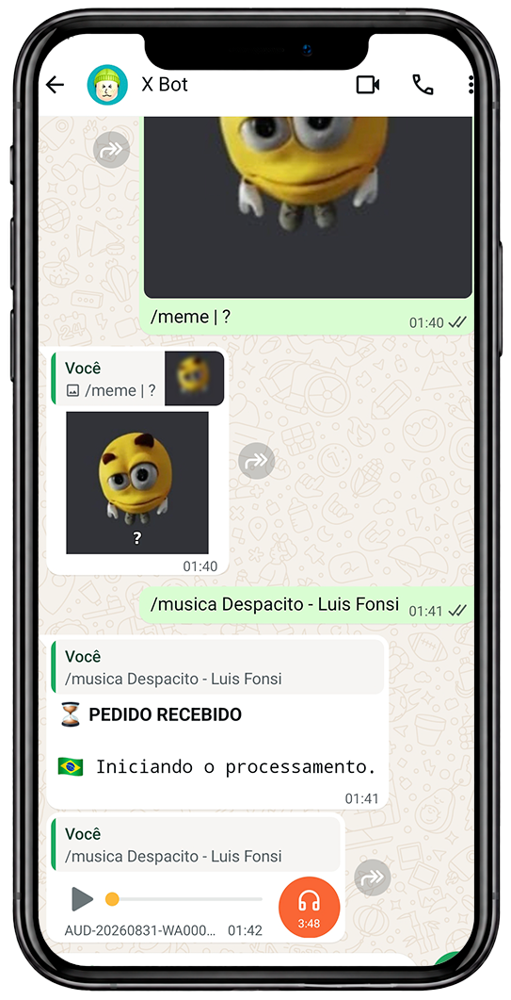
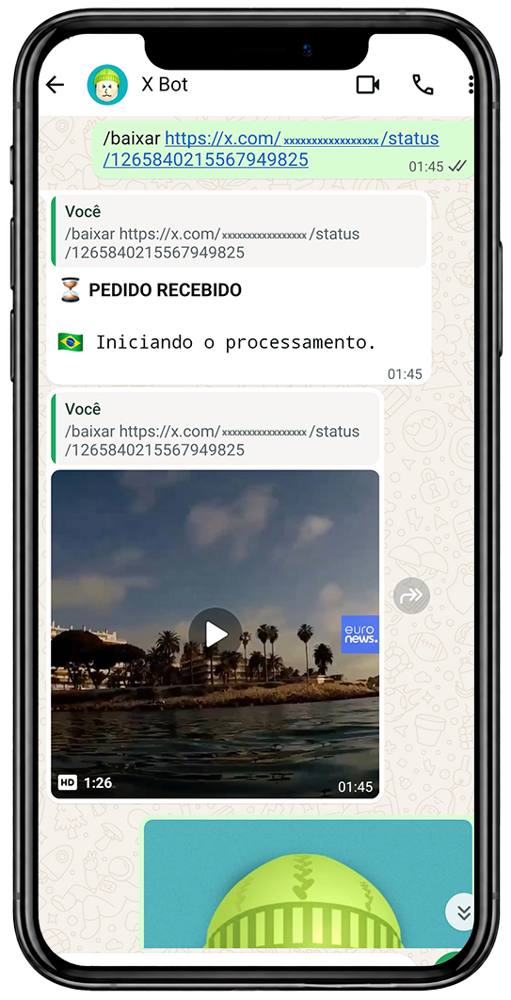
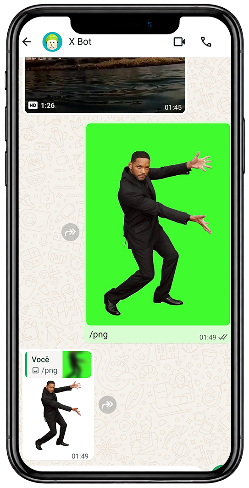
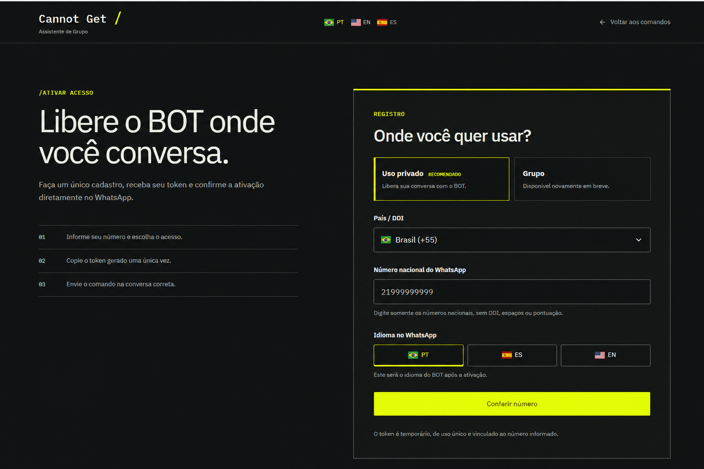
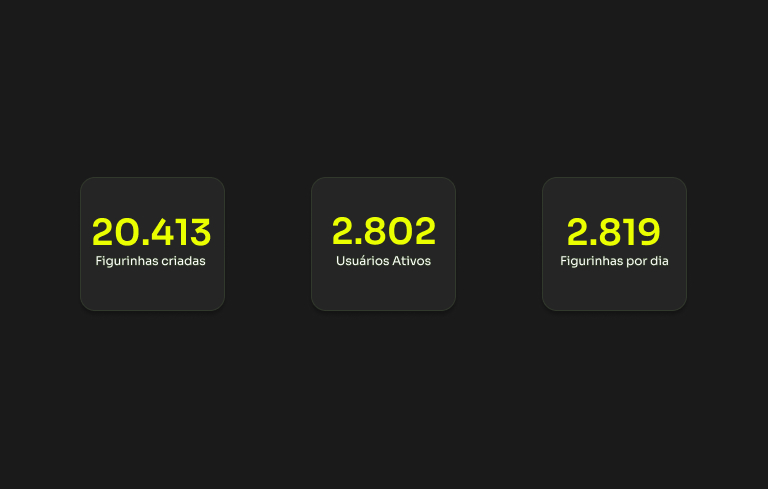

# Cannot Get

## Visão geral

Bot de diversão e utilidade para WhatsApp, criado para transformar e baixar mídias, executar ferramentas criativas e oferecer recursos de apoio à administração de grupos.

## Problema

Criar figurinhas a partir de diferentes formatos normalmente exige outros aplicativos e várias etapas fora do WhatsApp. O Cannot Get simplifica esse processo com comandos no próprio chat e reúne utilidades para facilitar a organização e a interação nos grupos.

## Funcionalidades implementadas

- Recepção de eventos e mídias por WhatsApp.
- Comandos para criação de figurinhas e uso das utilidades do bot.
- Criação de memes a partir de imagens.
- Busca e envio de músicas em áudio.
- Download de vídeos a partir de links.
- Remoção de fundo e geração de imagens em PNG.
- Recursos de apoio à administração de grupos.
- Integração com n8n por webhooks.
- Conversão de imagem, vídeo e GIF para WebP com FFmpeg.
- Filas com limite e controle de concorrência.
- Deduplicação de mensagens e respostas.
- Rate limiting por remetente.
- Limites de tamanho e duração de mídia.
- Allowlist de destinos e modo de execução sem envio real.
- Métricas de fila, healthchecks e logs para diagnóstico.
- Comunicação de novidades em uma comunidade com mais de 500 participantes.
- Regras de uso e tratamento de dados orientadas à LGPD.

## Em implementação

- Integração com o sistema de pagamentos do Mercado Pago para gerar automaticamente o token de assinatura após a confirmação do pagamento.

## Exemplos de uso

| Meme e música | Download de vídeo | Remoção de fundo |
|---|---|---|
|  |  |  |

### Ativação do bot

*Cadastro com token de uso único, escolha do contexto de uso e idiomas português, espanhol e inglês.*

## Duas arquiteturas independentes

### OpenWA

Ponte própria em **Node.js, Express e whatsapp-web.js**, mantida para automações em canais `@newsletter`, recurso que não era atendido pela Evolution API no período de implementação. Também gerencia sessão, eventos, filas, integração com o n8n e envio das mídias processadas.

### Evolution API

Arquitetura principal baseada em **Evolution API, Baileys e n8n**, escolhida por ser mais leve para a operação cotidiana. Utiliza webhooks para receber mensagens, obter e validar mídias, executar conversões e devolver as figurinhas pela API.

OpenWA e Evolution API são integrações distintas e não compartilham a mesma implementação.

## Infraestrutura e tecnologias

**Node.js, JavaScript, n8n, OpenWA, whatsapp-web.js, Evolution API, Baileys, Docker, FFmpeg, webhooks e APIs REST.**

Os serviços são separados em contêineres e possuem restrições de filesystem, recursos, privilégios e exposição de portas. O conversor utiliza diretórios temporários e remove os arquivos após cada processamento.

## Operação e confiabilidade

Logs, webhooks, filas, execuções do n8n e métricas de processamento permitem acompanhar o fluxo ponta a ponta, diagnosticar ocorrências e manter a estabilidade do serviço.

## Adoção

*Indicadores registrados em novembro de 2026.*

- Mais de 5 mil usuários acumulados.
- 2.802 usuários ativos.
- 20.413 figurinhas criadas.
- 2.819 figurinhas processadas por dia.
- Comunidade com mais de 500 participantes acompanhando novidades e atualizações.

## Atuação

Concepção e evolução do produto, definição dos fluxos, integração dos serviços, implementação das regras de uso, administração da comunidade e acompanhamento da operação. A atuação combina desenvolvimento de produto, automação, APIs e resolução de problemas em sistemas distribuídos.

## Status

Produto em operação e evolução contínua.
