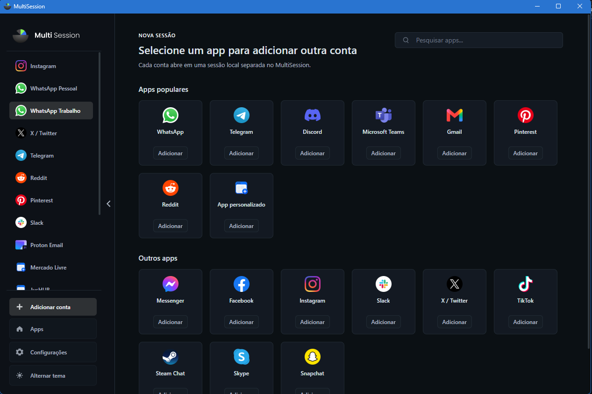
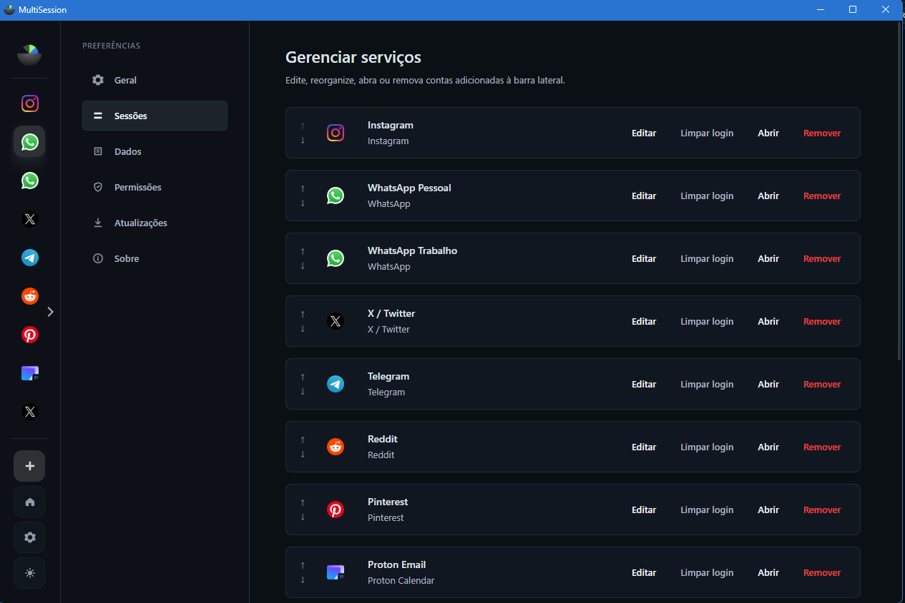
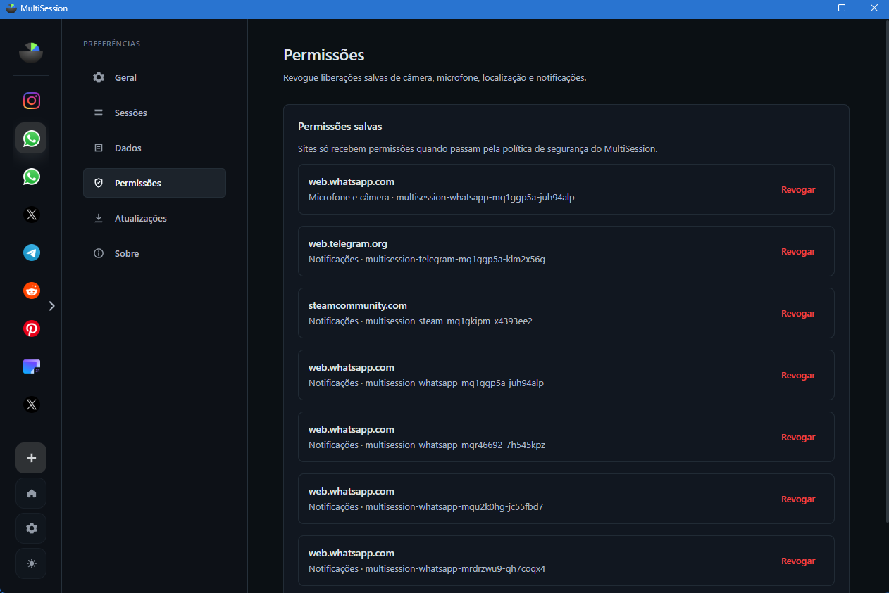
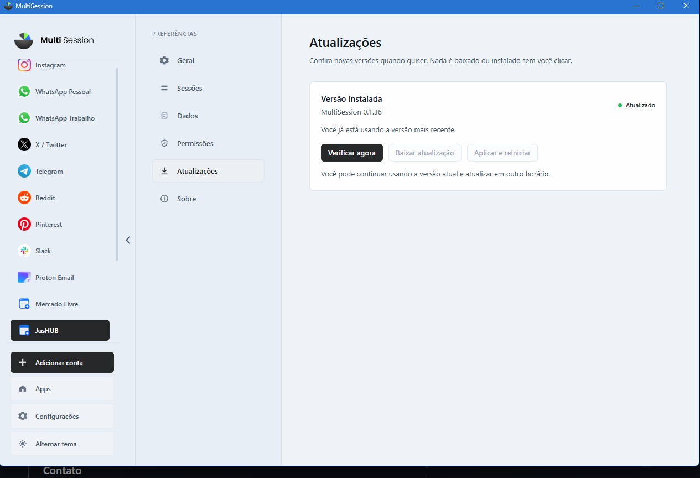
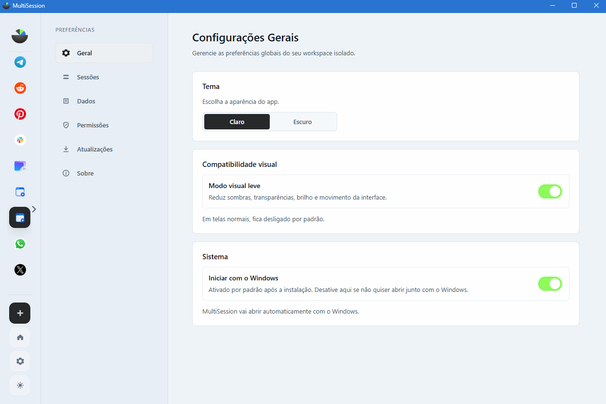

# MultiSession

## Visão geral

Aplicação desktop para Windows voltada ao gerenciamento de múltiplas contas de mensageiros, redes sociais e aplicações web. Cada conta utiliza uma sessão local isolada, permitindo alternar entre serviços sem misturar autenticações e dados.

*Tela de adição de contas, com catálogo de serviços e sessões organizadas na navegação lateral.*

## Problema

Profissionais que utilizam várias contas precisam alternar entre navegadores, perfis e abas, o que aumenta a fragmentação do trabalho. O MultiSession centraliza esses ambientes em uma interface desktop e preserva a separação entre as sessões.

## Funcionalidades implementadas

- Gerenciamento de múltiplas contas e serviços.
- Sessões persistentes e isoladas por conta.
- Navegação por WebViews com controle de URLs e pop-ups.
- Notificações do Windows direcionadas à sessão correspondente.
- Importação e exportação segura da configuração de contas.
- Gerenciamento de permissões e limpeza de dados locais.
- Temas claro e escuro e interface adaptada ao uso desktop.
- Atualização assistida, iniciada somente por ação do usuário.

## Evidências visuais

*Gerenciamento das contas adicionadas, com opções de edição, reordenação, abertura, limpeza de login e remoção.*

*Controle das permissões concedidas a cada serviço e sessão, incluindo câmera, microfone, localização e notificações.*

*Verificação manual de novas versões, sem baixar, instalar ou reiniciar o aplicativo sem ação do usuário.*

*Preferências de tema, compatibilidade visual e inicialização junto ao Windows.*

## Arquitetura e tecnologias

**TypeScript, JavaScript, Electron, Node.js, HTML, CSS, Zod, Vitest, Playwright e Electron Builder.**

O projeto separa processo principal, preload, renderer e contratos compartilhados. A comunicação sensível passa por uma API limitada no preload e por validação dos dados recebidos pelo processo principal.

## Segurança e qualidade

- Isolamento de contexto e bloqueio de integração Node.js nas páginas externas.
- Validação de IPC, URLs, partições e permissões.
- Controle de navegação e anexação de WebViews.
- Testes unitários de schemas e políticas de navegação.
- Smoke tests E2E para contas, sessões, navegação, importação e limpeza de dados.
- Logs locais limitados e sem conteúdo de conversas, cookies ou tokens.

## Atuação

Concepção e evolução do produto, definição de requisitos, arquitetura Electron, implementação das funcionalidades, revisão de segurança, automação de testes, documentação e preparação do fluxo de releases. O desenvolvimento utilizou agentes de IA com instruções de escopo, critérios de aceitação e revisão humana do resultado.

## Status

Beta funcional em evolução. O código-fonte é privado; este estudo de caso apresenta apenas informações técnicas sanitizadas.
