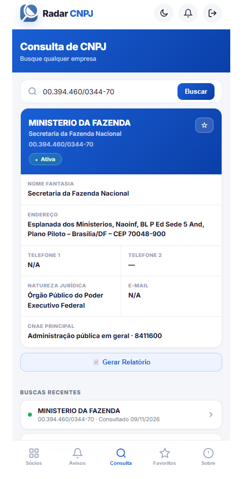
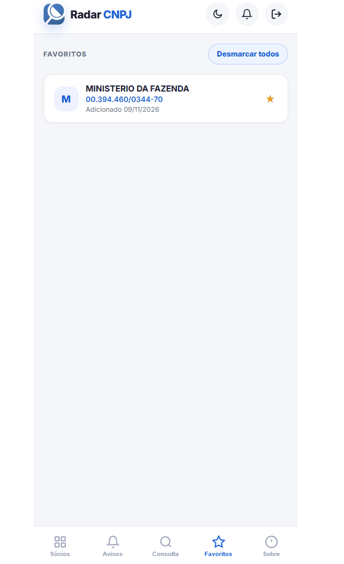
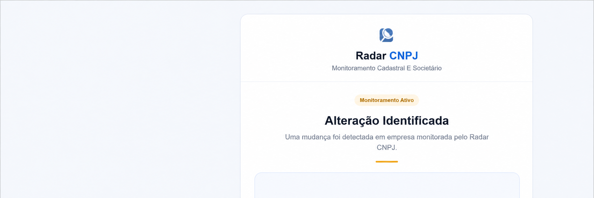

# Radar CNPJ

## Visão geral

Aplicação web/PWA para centralizar consultas e acompanhamento de informações cadastrais de empresas e sócios, com acesso também por dispositivo Android.

## Problema

Informações empresariais podem estar distribuídas entre diferentes fontes e exigir consultas repetitivas. O Radar CNPJ concentra pesquisa, acompanhamento e geração de relatórios em um único fluxo.

## Funcionalidades implementadas

- Consulta e pesquisa de CNPJ.
- Visualização de empresas e quadro societário.
- Histórico de consultas recentes.
- Empresas favoritas.
- Avisos de alterações cadastrais.
- Notificações no navegador.
- Temas claro e escuro.
- Geração e compartilhamento de relatórios.
- Experiência PWA e integração com Android por Capacitor.

## Evidências visuais

  

*Consulta cadastral, histórico recente e geração de relatório.*

  

*Cadastro de empresas favoritas para acesso e acompanhamento recorrentes.*

*Alerta automático por e-mail após a identificação de uma alteração em empresa monitorada.*

## Arquitetura e tecnologias

**JavaScript, HTML, CSS, n8n, APIs REST, PWA, Docker, Nginx e Capacitor.**

O frontend consome APIs externas e webhooks do n8n para consultar, processar e disponibilizar dados. O projeto possui configurações de distribuição web e empacotamento para Android.

## Automação e integração

O n8n atua como camada de orquestração entre o frontend e os serviços de dados. A aplicação trata timeout, erros de consulta e respostas de diferentes fontes, preservando um fluxo único para o usuário.

## Atuação

Desenvolvimento da aplicação, implementação das integrações, experiência PWA, ajustes para Android, favoritos, pesquisa, temas e evolução da interface. O projeto demonstra transformação de uma necessidade de negócio em produto digital integrado.

## Status

Piloto em desenvolvimento. O código-fonte permanece privado.
